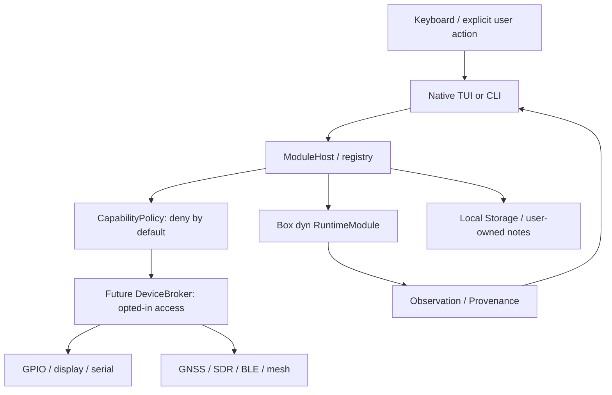
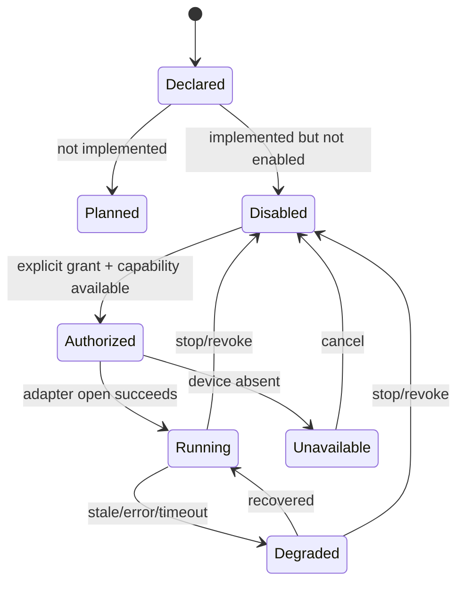

# Rust-Boy | Trait-based object model

Rust-Boy uses object-oriented **encapsulation and polymorphism** in idiomatic Rust: structs own state, traits describe behavior, and dependency injection composes adapters. Rust deliberately does not offer class inheritance. A trait object (`Box<dyn RuntimeModule + Send>`) is an **in-process abstraction**, not a safe binary plugin format or an OS security boundary.

## System composition



**Current implementation scope:** `RuntimeModule` and `ModuleHost` provide trusted in-process polymorphism and capability prechecks. A separate pure `ModuleLifecycle` state machine, `Observation<T>` envelope and `SampleBuffer<T>` have been authored for G1. The new CLI can print a finite set of local NDJSON host samples. These implementations remain **uncompiled and unverified** in this workspace; the live TUI and notes code still call existing services directly. There is no OS isolation, physical device broker, background scheduler or loaded third-party plugin.

## Major objects / responsibilities

| Object / trait | Responsibility | State ownership |
| --- | --- | --- |
| `ModuleDescriptor` / `ModulePlan` | Stable ID, readiness, evidence and dependency metadata | Immutable manifest/catalog |
| `RuntimeModule` trait | Polymorphic, object-safe internal module contract | Concrete module implementation |
| `ModuleHost` | Registration, duplicate and readiness checks, capability policy **precheck**, poll outcomes | Module collection and user grants |
| `PermissionSet` | Initially offline/read-only; manual grants require explicit application action | Host, not an adapter |
| `ModulePoll` | Explicit `Sample`, `Denied`, `Failed` status for observability | Return value, no hidden success |
| `Observation<T>` (planned typed envelope) | Source, time, unit, validity and provenance of measurements | One sample; enforce data constraints |
| `DeviceBroker` (G2 planned) | Authorized OS I/O handles for selected hardware | Controlled platform adapter |
| `InputSource` / `DisplayBackend` | User actions and display snapshots across targets | OS-specific adapter |
| `LocationSource` / `Receiver` / `MeshTransport` | Explicit opt-in field interfaces | Separate G3 adapters |
| `LocalStore` | Versioned persistence, export and deletion | Device-owned storage |

## Polymorphism contract

The G0/G1 in-process object must be simple enough for `dyn` dispatch and predictable testing:

```rust
pub trait RuntimeModule: Send {
    fn id(&self) -> &'static str;
    fn capabilities(&self) -> &'static [Capability];
    fn sample(&mut self) -> Result<ModuleSample, String>;
}

// Deliberately do NOT add:
// - async fn methods to this trait (not directly dyn-compatible)
// - generic methods or associated constants
// - unsafe FFI handles in domain types
```

Use concrete generic adapters for high-throughput SDR and packet decode paths where static dispatch provides clearer performance, then normalize data into a typed/event envelope at the boundary. Do not allocate one trait object for every incoming RF sample.

### Permission flow

1. Configuration starts with no grants for network, radio, GPIO, location, BLE or transmission.
2. A user explicitly enables a module and selects a compatible device or data source.
3. `ModuleHost` checks every declared required capability before invoking `sample`.
4. `DeviceBroker` (future) must issue scoped handles *after* a separate authorization check; only the broker should own OS I/O resources.
5. Revocation or device loss yields a visible `Denied`/`Unavailable` state and must shut down resources.

**Critical distinction:** a capability array is a policy declaration; a malicious Rust module can still call `std::fs` or sockets if linked in-process. Real plugin isolation requires a separate process/sandbox, broker-only handles, and security review. G4 explicitly avoids loading untrusted native modules.

## Proposed crate evolution

```text
crates/
  pipboy-core/                  # Domain, policy, manifests, objects
    src/blueprint.rs            # Module + evidence catalogs, graph validator
    src/runtime.rs              # RuntimeModule/ModuleHost testable skeleton
    src/metrics.rs              # Existing stat telemetry
    src/notes.rs                # Existing notes
  pipboy/                       # Current CLI + Ratatui frontend
  rustboy-hal/                  # G2 PROPOSED; no crate yet
  rustboy-display/              # G2 PROPOSED; no crate yet
  rustboy-location/             # G3 PROPOSED; no crate yet
  rustboy-radio/                # G3 PROPOSED; no crate yet
  rustboy-mesh/                 # G3 PROPOSED; no crate yet
```

Keep future crates **out of the Cargo workspace** until the corresponding gate has passing tests. File trees are planning targets, not a claim of implemented modules.

## Lifecycle state machine (pure G1 model authored; integration pending)



`Ready` (legacy G0 registry) must not mean `Running` or `CI verified`. Roadmap manifests instead use `implemented_unverified` and `planned`. Display separate **implementation** and **runtime connectivity** statuses; avoid conflation.

## Data contract (G1 prototype authored; validation pending)

The core now declares a generic observation with schema_version (1), source_id, provenance, captured_wall_unix_ms (optional), captured_session_ms (monotonic-process-relative), unit (optional), value (optional), quality (valid, stale, unknown, invalid) and expires_after_ms (optional).

- **Valid/stale** requires a value; **unknown/invalid** must not carry one. A numeric zero is still a real value.
- Session-relative clock values are only comparable within a single process launch; wall clock may be unavailable or incorrect.
- A sample can move from valid to stale when its TTL expires, never automatically back to valid.
- CLI sampling currently writes a finite number of NDJSON host snapshots to stdout. The TUI and full ModuleHost integration are still pending.
- No data collector, file exporter, device scanner, transmitter, or automatic sync has been enabled by this code.

See core files observation.rs, buffer.rs, lifecycle.rs, and CLI file sampling.rs. Re-run test and formatting checks before accepting these structures as stable data contracts.

## Testing strategy

- **Unit**: registration, duplicate IDs, deny-before-poll, corrupted manifests, cyclic graph, schema version.
- **Contract**: fake input/display/transport drivers and module event sequencing.
- **Simulation**: hardware unavailable, permission revocation, malformed GPS/SDR frames.
- **UI**: Ratatui memory-backed snapshots and keyboard event replay at varied terminal sizes.
- **Hardware-in-loop**: selected Pi, screen, encoders, serial, GNSS and receive-only RF dongle after fixture tests.
- **Release**: dependency/SBOM/license review, signed artifacts and reproducible platform smoke tests.

## References

See [L01, L02, L03, L04, L05, L16, L17, L22 and L25](LITERATURE_MATRIX.md) for the implementation rationale and limitations.
