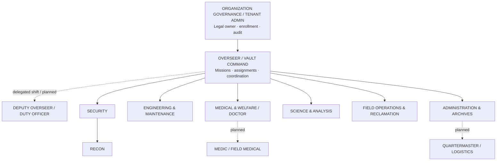

# Rust-Boy | Common Vault organizational chart

**Status: canonical project design template; not a live directory, HR policy, permission grant, or implemented organization enrollment.** The machine-readable source is [`catalog/vault_org_chart.json`](../catalog/vault_org_chart.json). Keep its `role_id` values aligned to the existing Rust `PRESETS`; do not rename persistent workbench, task, or peer IDs to make the organizational chart attractive.

The reporting tree is **not a permission tree**: titles, ancestry and role presets are not authorization tokens. Existing local `tasks.json` and `peers.json` remain **unencrypted at rest** and must not hold protected patient information or secrets.

The chart is a **common default for an independent vault or an adopter's site**. Every company, community organization, institution or hospital may configure its actual departments, reporting relationships, appointment rules and access policies later. The organizational chart informs assignment routing; it **does not create authorization**. Separately authenticated people, devices, organizations, capabilities and dataset grants remain requirements of the [RB↔RB synchronization roadmap](RB_SYNC_ROADMAP.md).

## Default hierarchy



**Solid line:** default reporting/escalation relationship. **Dotted line:** an optional *organizational position* with **no corresponding Rust preset** today. **Organization Governance** is the tenant administrator or accountable owner, *not* a Vault operator role. **Custom** is an editor/tool-pinning preset and is deliberately not part of the reporting tree. The diagram uses neutral original text, not game art.

The Overseer coordinates mission execution but does **not** automatically outrank clinical professional obligations, emergency service law, corporate security policy, or an institution's data owner. Departments can have multiple teams, shifts, sites and devices. No assumption of one person per title or one RB per employee.

## Stable Rust role mapping

| Reporting line / division | Existing Rust preset ID | Display role | Intended mission responsibility |
| --- | --- | --- | --- |
| Organization Governance | *none* | Organization owner/admin | Own tenant membership, key issuance, audit policy and site configuration; never derived from job profile |
| Vault Command | `overseer` | Overseer | Issues missions, delegates work orders, prioritizes incidents, reviews receipts and escalations |
| Deputy (optional) | *none (future designation)* | Deputy Overseer / Duty Officer | Acts only within documented, time-limited delegation; cannot inherit permissions from title |
| Security | `security-chief` | Security | Coordinates incident response, access events and permitted camera/security situational views |
| Security → Recon | `recon` | Recon | Reports field observations, geospatial findings and status; default Security chain, configurable later |
| Engineering | `head-engineer` | Maintenance | Owns infrastructure, network/service diagnostics and equipment work orders |
| Medical | `vault-doctor` | Doctor | Leads medical/welfare coordination and acts as clinical review authority where applicable |
| Medical → Medic (optional) | *none (planned)* | Medic | Field medical response and proposed nine-line request path to Doctor; **not yet a released profile** |
| Science | `university-researcher` | Scientist | Research, analysis, verified observations and technical/scientific advice |
| Field Operations | `reclamation-scout` | Reclamations | Field operations, survey/site work and physical logistics requests |
| Administration | `records-custodian` | Archivist | Non-clinical records, work evidence, indexing, audit/retention workflow |
| Administration → Logistics (optional) | *none (planned)* | Quartermaster | Inventory/asset issue and supply chain, without implicit store/device secrets |
| Unassigned/tool authoring | `custom` | Custom | **Not a department or rank**; tool workspace does not inherit Command privileges |

**Lore provenance:** Bethesda's official *Fallout 76* [Overseer, Overseen](https://help.bethesda.net/app/answers/detail/a_id/49597/) quest explicitly describes Overseer, Security Chief, Head Engineer and Doctor roles in a training simulation. It is **not** a publisher-certified exhaustive Vault-Tec organizational chart. Recon, Reclamations, Scientist, Archivist and functional departments are Rust-Boy's operational interpretation, documented in the [lore evidence matrix](VAULT_TEC_LORE_MATRIX.md). Deputy, Medic and Quartermaster are **proposed** positions, not claims that those presets ship or that all are official game canon. The unofficial Vault 8/City handbook is not treated as binding primary canon.

## Command and reporting model

1. **Organization owner/admin** creates a vault/tenant, authorizes device enrollment, appoints people, delegates roles and maintains revocation. A *tenant* may have multiple sites/vaults later; each site's Overseer controls only its assigned scope. Organizational admin can be a different human than the Overseer.
2. **Overseer / Vault Command** creates a mission, assigns accountable division(s), priorities and due dates, identifies the required deliverables and named escalation contact. A mission can contain several jobs assigned to different divisions, but the current task store does **not** yet have hierarchical mission/job entities.
3. **Division lead** accepts or rejects delegated work, assigns one or more individuals/equipment within authorized scope and reports blockers. An organization may delegate assignment authority to a duly appointed shift lead; merely selecting the Maintenance or Security profile does not grant a manager API.
4. **Operator + RB device** receives its specific job, explicitly acknowledges it, records progress and reports completion, blockade or emergency. Receiving device storage is **not** proof of human acknowledgment.
5. **Command reconciles** received status and accepted evidence. Completion requires whatever department sign-off the organization specifies. No peer silently edits another person's progress history.
6. **Cross-division work** is issued as a shared mission containing individually scoped tasks, not by granting every participant access to all department data. Example: power failure → Engineering repair, Security perimeter, Field Logistics supply; Medical controls its own clinical escalation if patients are affected.

### Default assignment routes (future organizational sync)

| Issuing role | Route | Approval / escalation | Allowed visibility by default |
| --- | --- | --- | --- |
| Overseer | Command → departmental lead → named worker/device | Designated division lead; org policy | Mission metadata and authorized status, not every department's private records |
| Security | Security → Recon | Security lead and incident commander when appointed | Site incident references only where authorized; no blanket camera/location export |
| Engineering | Engineering → Maintenance personnel | Qualified engineering/site authority | Equipment/work-order fields, no unrelated patient or HR information |
| Medical | Doctor → Medic (once implemented) | Licensed clinical supervisors and institution's policies | A minimal non-PHI notification only until regulated review |
| Science | Scientist → approved research contributors | Study/data owner and governance oversight | De-identified/synthetic approved research datasets only |
| Reclamations | Field Operations → site team | Field lead and safety reviewer | Scoped survey/site data; sensitive locations require separate sharing grant |
| Archivist | Administration → records staff | Records owner; retention/legal policies | Audit references and non-sensitive documentation, not unrestricted source files |

**Incident overlays:** Appointed incident commanders, safety officers and emergency coordinators can temporarily cross ordinary reporting lines **within explicitly scoped authority**. These are *appointments* with start/end, approver, incident ID, audit and revocation, not permanent titles or UI toggles. An emergency beacon or medical nine-line request is a **notification**, not automatic authorization to expose restricted medical data.

## RB-to-RB sync scopes derived from the chart

```text
Organization (verified tenant)
  └── Vault/site (command scope)
       ├── Division (functional / policy group)
       │    └── Team / shift (optional assignment target)
       │         └── Authenticated operator(s)
       └── Enrolled RB devices (separate identity and lifecycle)

Each event: org + vault + mission/job + target operator/device + classification
Each send: sender key + human authority + receiver identity + dataset grant
```

A record can cross departments only when its owner and the verified organization policy authorize that specific event/dataset. **Reporting parentage does not imply read-all access.** Examples: Overseer can see job acceptance and ETA without reading confidential clinical notes; Security can respond to a medical emergency without inheriting patient charts; an Archivist can track that evidence was submitted without viewing an encrypted payload.

### Minimum organizational entities for R1

- `Org`: immutable `org_id`, human-readable name, enrollment authority, policy version.
- `VaultSite`: `vault_id`, `org_id`, location/sector *if explicitly supplied*, site command designation.
- `Unit`: stable `unit_id`, `vault_id`, `parent_unit_id`, `division`, disabled/deleted state; an acyclic reporting tree.
- `Appointment`: `operator_id`, `unit_id`, `position_id`, approver, validity, delegation scope; multiple duty assignments possible.
- `DeviceAssignment`: distinct `device_id`, owner/site/assigned operator and key epoch; a device may be reassigned without losing its cryptographic identity/history.
- `Grant`: subject, action, dataset, object/mission scope, classification ceiling, expiry and revocation. **Not inferred from role titles or tree traversal.**
- `Mission` and `Job`: command issuer, target unit/operator/device, independent revisions and accepted receipt/acknowledgment/progress histories.

R1 must start with **data-only schemas and deterministic tests**. The existing `PRESETS`, `WorkBenchStore`, `TaskStore`, task API and OpenSSH v1 bridge must remain compatible. Real org authentication, multiple sites and sync require later implementation/review. In current code, `mission-board` availability is determined from local tool pins and the active local role is mutable; **this is not suitable as a hospital/enterprise access control**.

## Organization profiles (defaults, not separate implementations)

| Deployment | Root role and variation | Restriction |
| --- | --- | --- |
| Standalone / hobby | Operator may act as Overseer; optional single-person teams | Preserve current manual pairing; no enterprise services required |
| Small group / volunteer | Site coordinator appointed as Overseer; several field teams | Membership approval, bounded consent and local record sensitivity rules |
| Company / facility | Manager as Overseer; IT, Security, Maintenance, Records divisions | Actual HR/IT identity provider and assigned site/device policy required |
| Hospital / clinical campus | Operations/incident command as Overseer-like coordinator; clinical chain independent | **No PHI** on current RB storage or peer sync; clinical roles, legal oversight, EHR access and emergency protocols require separate security/compliance assessment |
| Multi-site fleet | Parent org with multiple independent `VaultSite` command trees | Cross-site exchange denied by default; avoid global master Overseer access unless separately granted |

## ORG-1 Rust core implementation (2026-10-26)

The first **pure-data** organizational graph now exists in [`pipboy-core::organization`](../crates/pipboy-core/src/organization.rs) and is exported by `pipboy-core/src/lib.rs`. The module includes strictly validated `Organization`, `VaultSite`, `Unit` (`Division` or `Team`), `Operator`, `Appointment`, `DeviceRecord` and draft `Grant` records. The graph is **not** read from or written to existing `PIPBOY_HOME` state; task, peer, Messenger, workbench and SSH schemas are unchanged.

- Structural validation: bounded record counts, stable unique IDs, printable names, existence of referenced organizations/sites/operators, and same-Vault reporting paths.
- Multi-tenant isolation: cross-organization appointments, device assignments or draft grants fail validation. A unit's reporting parent must be within its own Vault.
- Human appointments: an explicit approver reference, start/end interval, optional revocation metadata and position ID. These are records, **not evidence that the approver is authenticated or authorized**.
- Device lifecycle: `unenrolled / pending / recorded_active / suspended / revoked` are recorded *labels*, not cryptographic proof that a device key is valid.
- Draft grants: subject may be an operator or device, with an organization/Vault scope, data category, action, validity interval and revocation flag. These are untrusted data and cannot authorize a read, assignment or sync operation until verified policy + identity are implemented.
- Pure reporting lookup: `reporting_chain(unit_id)` follows same-Vault Unit ancestry but grants no inherited rights. It never traverses to another site or organization.

The native unit fixtures exercise two organizations, three Vault sites, multiple teams and operators, reporter chains, duplicate/cyclic/missing parents, org-crossing appointments/devices/grants, reassignment, invalid dates, and strict JSON serialization. No listeners, discovery, new storage, hospital data or background sync were enabled.

**Next gate:** an independently authenticated human/organization/device enrollment flow and a policy decision point before using these records to route actual jobs. Do not apply draft grants to existing `/api/tasks` or `peer` routes merely because this structural model validates.

## ORG-2 policy preflight (offline tests only)

[`pipboy-core::organization_policy`](../crates/pipboy-core/src/organization_policy.rs) now models a **proposed exchange** between one named operator and one assigned RB device, for a single organization's Vault, dataset and action. It requires all of these *structural candidates* before proceeding to a future verified authorization stage:

- Complete, valid and internally consistent organization graph; organization/Vault scope matches the request.
- Operator record is active in that organization; assigned device is in the same Vault, marked `recorded_active`, and assigned to that operator.
- Appointment is for a unit within that Vault, non-revoked and active at the supplied time.
- **Both** a draft operator grant **and** a distinct draft device grant match the Vault, action, dataset and validity interval; no union of partial grants.
- No privilege inheritance from Overseer title, team ancestry, another Vault or another organization. Every failure returns a denial state.

The sole positive result is `CandidateForVerification`, **not `Allow`**. The evaluator has no authenticated principal, device-key proof, trusted wall clock, verified grant issuer, live integration, persistence or network transport. Its time argument is explicitly `time_unverified`. Do **not** use `CandidateForVerification` to open any API route, SSH session or dataset read. A future policy decision point must validate signatures/identities, grant issuer authority, current revocation and trusted time *independently* before allowing an operation.

Synthetic Rust tests check two organizations and three Vaults, valid/expired/revoked appointments, disabled users, revoked devices, absent/revoked operator and device grants, wrong dataset/action, mismatched Vaults and corrupted graphs. No existing dashboard, peer, task or radio behavior changes.

### Upcoming implementation gates

- **ORG-0 (this pass):** common, stable diagram; machine-readable role/preset mapping; documented non-role positions; CI drift detection.
- **ORG-1:** typed `Org`, `VaultSite`, `Unit`, `Appointment`, `DeviceAssignment`, `Grant`; explicit data authority boundaries; no sockets.
- **ORG-2:** offline model tests for multi-vault, cross-tenant denial, cycles, reassignment, shift delegation expiry, organizational revocation and incident scope.
- **ORG-3:** separate admin enrollment and named-operator identity; connect to the [RB sync R1–R3 roadmap](RB_SYNC_ROADMAP.md) after review.
- **ORG-4:** Vault desktop **ORGANIZATION** subview (org units, people, enrolled devices and pending assignments) backed by the secure API. No automatic fleet/peer discovery. Handheld shows only assigned unit and direct supervisor where authorized.

**Hard acceptance:** never change Rust role IDs to fit a narrative hierarchy; never infer access from reporting relationships, a nickname, discovery or a shared radio key. The entire chart is a design template, not a deployment-specific policy.
